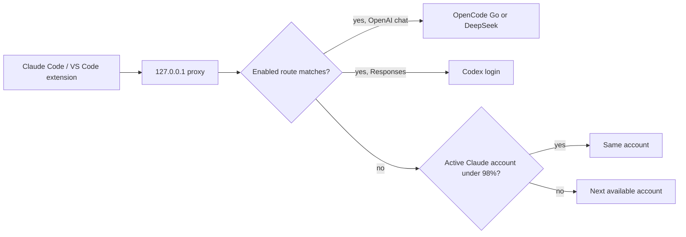

<div align="center">

# Claude Account Pilot

**When a Claude account reaches 98%, the next one takes over. Haiku can go to DeepSeek. One screen.**

[](README.md)
[](README.tr.md)

[](https://github.com/cumabozkurt/claude-account-pilot/actions/workflows/ci.yml)
[](https://github.com/cumabozkurt/claude-account-pilot/releases/latest)
[](LICENSE)
[](#install)

</div>

> **In one sentence:** Claude Account Pilot is a desktop app that keeps every Claude account you add on a local proxy, watches quota, switches to the next available account at 98%, and can send a chosen model (Haiku, by default) to OpenCode Go, DeepSeek, or a Codex login already on the machine.

Claude Code and the Claude Code VS Code extension keep talking to one address (`ANTHROPIC_BASE_URL`). The app speaks **English and Turkish**. It follows the operating system language the first time it opens.

The design comes from a pass over the 25 most-starred similar projects updated in the six months before 21 October 2026. The notes are in [docs/RESEARCH.md](docs/RESEARCH.md).

| English | Türkçe |
|---|---|
|  |  |

The amber line in these captures is the headless Linux session used to take them: it has no OS secret store. On a normal macOS, Windows, or desktop Linux login the same keys go into the system keychain and that line stays hidden.

---

## Contents

- [Why](#why)
- [Features](#features)
- [Install](#install)
- [First run](#first-run)
- [The screen](#the-screen)
- [How routing works](#how-routing-works)
- [Quotas, tokens, cost](#quotas-tokens-cost)
- [Language](#language)
- [Security](#security)
- [Stack](#stack)
- [Limitations](#limitations)
- [Development](#development)
- [License](#license)

## Why

Claude Desktop, Claude Code, and the VS Code extension each hold one login. When that account hits its limit, the next step is a manual logout and login. A second provider (DeepSeek through OpenCode Go, a Codex subscription, a Cursor or Antigravity install) is a separate app with a separate quota you cannot see from Claude.

This app is the small control surface for that: accounts, providers, and model routes, each with an on/off switch, plus a proxy that stays up in the tray.

## Features

| | |
|---|---|
| Accounts | Add Claude API keys or OAuth tokens. Sign in to a Claude Pro/Max subscription (browser PKCE, paste the code) or import `~/.claude/.credentials.json`. Import a Codex login found on this computer. Each row has an on/off switch. |
| Auto switch | The active account is kept until a quota window reaches **98%** (editable, 50–99). The next enabled account under the line is used. A short per-minute 429 does not mark the quota full. |
| Always on | The proxy polls about once a minute, and it also reads rate-limit headers on every response. |
| Model routes | First enabled glob wins. The built-in rules send `*haiku*` to OpenCode Go `deepseek-v4-flash` or to DeepSeek `deepseek-chat`. Both ship **off**. |
| Codex | If `~/.codex/auth.json` exists, the app can reuse that login and speak the Responses API. The token is read in place, not copied. |
| Cursor and Antigravity | Detected when their config directories exist. They have no stable public messages API, so traffic is **not** rewritten through them. |
| Numbers | Percent when a provider publishes one, plus input/output tokens, cache tokens, and an **estimated** USD cost. |
| Tray | Menu-bar / system tray, percent in the macOS menu bar, optional always-on-top widget on every platform. |
| Claude settings | One button writes `ANTHROPIC_BASE_URL` into `~/.claude/settings.json` (the file the CLI and the VS Code extension read) and can restore the backup. A second action writes the chosen subscription into `~/.claude/.credentials.json` and, on macOS, the Claude Code keychain item, for clients that ignore the proxy. |
| Languages | English and Turkish. OS language on first launch, switch remembered. |
| Privacy | Listens on `127.0.0.1` only. No telemetry. Prompts are not stored. Secrets go to the OS keychain. |

## Install

Download a build from the [latest release](https://github.com/cumabozkurt/claude-account-pilot/releases/latest).

| System | File |
|---|---|
| macOS, Apple Silicon | `Claude.Account.Pilot-<version>-mac-arm64.dmg` (or `.zip`) |
| macOS, Intel | `Claude.Account.Pilot-<version>-mac-x64.dmg` (or `.zip`) |
| Windows 10/11 x64 | `Claude.Account.Pilot-Setup-<version>-win-x64.exe` or `Claude.Account.Pilot-Portable-<version>-win-x64.exe` |
| Linux x64 | `Claude.Account.Pilot-<version>-linux-x86_64.AppImage` or `Claude.Account.Pilot-<version>-linux-amd64.deb` |

The builds are not code-signed yet.

- **Windows:** SmartScreen may say the publisher is unknown. Choose **More info → Run anyway**.
- **macOS:** Right-click the app → **Open**. If Gatekeeper says the app is damaged, run `xattr -dr com.apple.quarantine` on the app.
- **Linux AppImage:** `chmod +x` the file. Some distributions need `libfuse2`.

Closing the window leaves the proxy running. Quit from the tray menu.

## First run

1. Open the app. If the system language is Turkish, the interface is Turkish.
2. Add each Claude account (a label, an API key or a bearer token). Turn on only the ones that should receive traffic.
3. Click **Write Claude settings**. Restart Claude Code, or close and reopen the extension tab.
4. Or copy the environment block into the shell you launch Claude from:

```bash
ANTHROPIC_BASE_URL=http://127.0.0.1:15721
ANTHROPIC_API_KEY=pilot-local
```

The local key is only a flag so Claude Code agrees to start. The proxy ignores it and uses the accounts you added.

5. To send Haiku to DeepSeek: turn **OpenCode Go** on, add that account's API key, and turn on the `*haiku*` route. Other models stay on Claude.

## The screen

One page, top to bottom:

- Proxy address, copy-env, write/restore Claude settings, start/stop.
- Switch threshold and port. Launch at login. Floating widget.
- Providers, each with a switch and a short note about what that provider can actually report.
- Accounts, with a quota bar, 5-hour and 7-day tags when they exist, token counts, and estimated cost.
- Logins found on this computer.
- Model routes, in priority order.
- A short activity list (model, provider, account). Not the prompt.

## How routing works



Claude-to-Claude calls are passed through, including streams. Translated calls are converted both ways, including tool calls and server-sent events. A Cursor or Antigravity route returns a clear error instead of a fake answer, because those subscriptions do not expose a tool-capable HTTP API this app can drive safely.

## Quotas, tokens, cost

| What you see | Where it comes from |
|---|---|
| 5h / 7d percent | Anthropic rate-limit headers on a proxied response, or `GET /api/oauth/usage` when the account is an OAuth token |
| Request or token window | `anthropic-ratelimit-*-limit` and `*-remaining` when the 5h/7d headers are absent |
| Token counts and estimated cost | The `usage` object on each response, priced with a built-in table (Haiku, Sonnet, Opus, DeepSeek, GPT/Codex). **Estimates, not an invoice.** |
| DeepSeek balance | `GET /user/balance` when that endpoint answers |
| Codex, OpenCode Go, Cursor, Antigravity percent | Often **absent**. The card says so. Tokens still accumulate for traffic that actually passed through the proxy. |

The switch watches the higher of the 5-hour and 7-day windows when those exist. Otherwise it watches the best percent the headers provided. An unknown percent does not count as "full".

## Language

First launch reads the OS locale (`tr` and `tr-TR` → Turkish, anything else → English) and stores the choice. **EN / TR** in the header changes it immediately. The same dictionaries drive the tray menu. The landing page does the same with the browser language and `localStorage`.

## Security

- The proxy binds to `127.0.0.1` only.
- API keys and pasted tokens are encrypted with Electron `safeStorage` (macOS Keychain, Windows DPAPI, Linux Secret Service). If the OS store is unavailable, the app says so and falls back to an owner-only file.
- `config.json` stores labels and a secret handle, never the secret.
- A discovered Codex or Claude token stays in the file the official CLI wrote.
- Activity entries store the model name, provider, and account label.
- Add accounts that belong to you. This project does not add quota to a plan, and it is not for sharing one login across people. See [SECURITY.md](SECURITY.md).

## Stack

**Electron + TypeScript.** The window, the tray, and the proxy are one program. The rotation, translation, quota parsing, and settings writer do not import Electron, and the unit tests run them under plain Node.

Tauri 2 is the other stack that shows up constantly in the research (CC Switch, QuotaBar, Headroom). It produces a smaller binary. Electron was chosen because [Agent Switchboard](https://github.com/cumabozkurt/agent-switchboard) already publishes macOS, Windows, and Linux installers this way, and because the proxy and the UI can share one test suite. The tradeoff is a larger download. Details: [docs/RESEARCH.md](docs/RESEARCH.md).

## Limitations

- Anthropic may reject a subscription OAuth token that does not come from the official client. API keys keep working. Refresh uses the same JSON token endpoint as Claude Code. A login Claude Code currently has on disk is never refreshed. A rejected refresh (`invalid_grant`) is shown as "sign in again" and is not retried.
- Claude Desktop's chat app stores its own encrypted session. Switching credentials updates Claude Code and the VS Code extension. It does not sign the Desktop chat app into another account.
- OpenCode Go and DeepSeek do not publish a percent-used quota. You get tokens, estimated cost, and a DeepSeek balance when the API returns one.
- Codex quota windows appear only if the upstream sends them. The login file is read, not refreshed, by this app.
- Cursor and Antigravity have no public quota API and no stable local messages API that preserves Claude Code tool calls. They are detected, not routed.
- Prices in the cost column are list-price estimates for display.
- Builds are unsigned.
- The menu-bar percent is macOS-only. Linux and Windows use the tray tooltip and the optional floating widget, because a global menu bar is not how those desktops work.

## Development

Node.js 22 or newer.

```bash
npm ci
npm test
npm start
npm run dist
```

`npm test` compiles and runs the Node test runner (rotation, translation, proxy, settings, discovery, both languages). GitHub Actions runs those tests and builds installers for Linux, macOS (arm64 and x64), and Windows.

## License

[MIT](LICENSE) © 2026 Cuma Bozkurt
