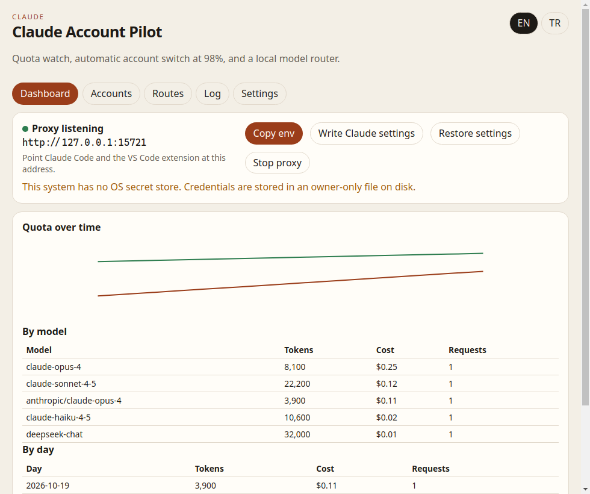
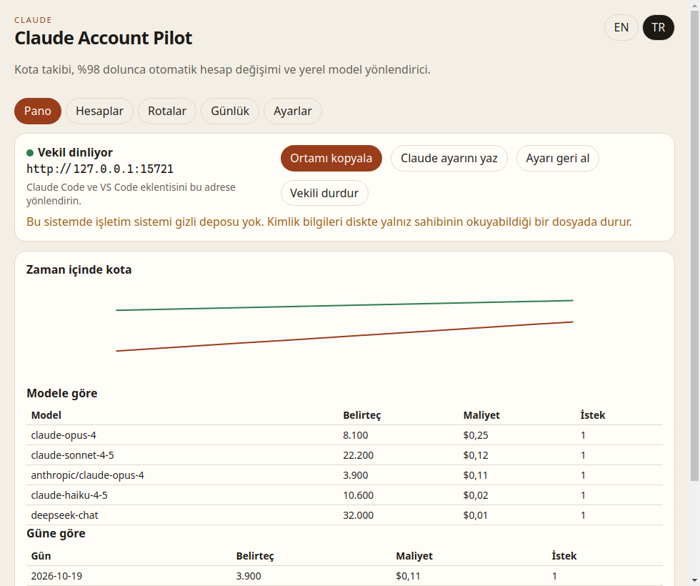
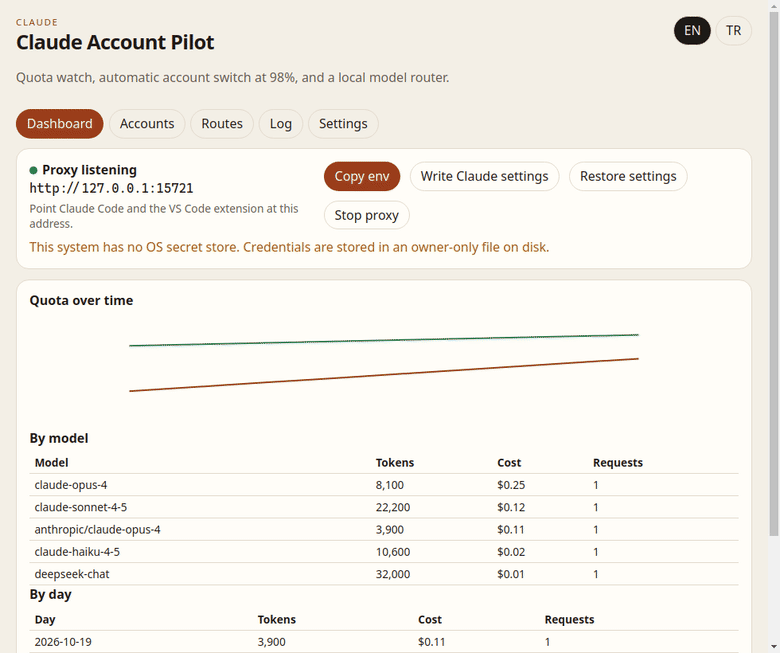
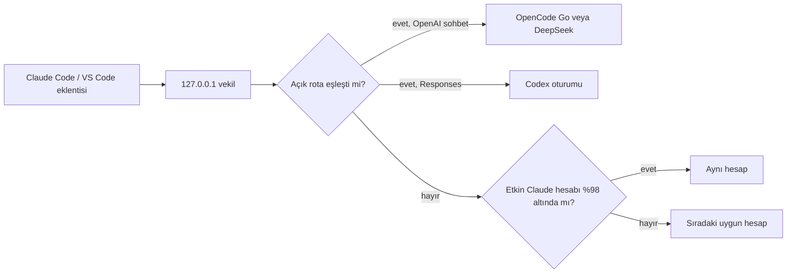

<div align="center">

# Claude Account Pilot

**Bir Claude hesabı %98'e gelince sıradaki hesap devralır. Haiku, DeepSeek'e gidebilir. Tek ekran.**

[](README.md)
[](README.tr.md)

[](https://github.com/cumabozkurt/claude-account-pilot/actions/workflows/ci.yml)
[](https://github.com/cumabozkurt/claude-account-pilot/releases/latest)
[](LICENSE)
[](#kurulum)

</div>

> **Tek cümle:** Claude Account Pilot, eklediğiniz Claude hesaplarını yerel bir vekilin arkasında tutan, kotayı izleyen, %98'de sıradaki uygun hesaba geçen ve seçtiğiniz modeli (varsayılan Haiku) OpenCode Go, DeepSeek veya bu bilgisayardaki Codex oturumuna gönderebilen bir masaüstü uygulamasıdır.

Claude Code ve Claude Code VS Code eklentisi tek adrese bakar (`ANTHROPIC_BASE_URL`). Uygulama **Türkçe ve İngilizce** konuşur. İlk açılışta işletim sistemi dilini kullanır.

Tasarım, 21 Ekim 2026'dan önceki altı ayda güncellenmiş en yıldızlı 25 benzer projenin okunmasından çıktı. Notlar: [docs/RESEARCH.md](docs/RESEARCH.md).

| English | Türkçe |
|---|---|
|  |  |



Bu resimlerdeki sayılar yerel bir demodur (`ada@example.com`, canlı oturum yok); grafik çizilecek bir çizgi bulsun diye. Sarı satır, ekran görüntüsünün alındığı başsız Linux oturumuna aittir; orada işletim sistemi gizli deposu yoktur. Normal bir macOS, Windows veya masaüstü Linux girişinde anahtarlar sistem anahtarlığına yazılır ve bu satır görünmez.

---

## İçindekiler

- [Neden](#neden)
- [Özellikler](#özellikler)
- [Kurulum](#kurulum)
- [İlk çalıştırma](#ilk-çalıştırma)
- [Ekran](#ekran)
- [Yönlendirme](#yönlendirme)
- [Kota, belirteç, maliyet](#kota-belirteç-maliyet)
- [Dil](#dil)
- [Güvenlik](#güvenlik)
- [Yığın](#yığın)
- [Sınırlar](#sınırlar)
- [Geliştirme](#geliştirme)
- [Lisans](#lisans)

## Neden

Claude Desktop, Claude Code ve VS Code eklentisi tek oturum tutar. O hesap dolunca yapılacak iş elle çıkış yapıp başka hesaba girmektir. İkinci bir sağlayıcı (OpenCode Go üzerinden DeepSeek, Codex aboneliği, Cursor veya Antigravity) ayrı bir uygulamadır; kotası Claude'un içinden görünmez.

Bu uygulama o iş için küçük bir kumanda: hesaplar, sağlayıcılar ve model rotaları, her biri bir anahtarla, artı tepside açık kalan bir vekil.

## Özellikler

| | |
|---|---|
| Hesaplar | Claude API anahtarı veya OAuth belirteci ekleyin. Claude Pro/Max aboneliğiyle giriş yapın (tarayıcı PKCE, kodu yapıştırın) veya `~/.claude/.credentials.json` içe aktarın. Bu bilgisayarda bulunan Codex oturumunu da içe aktarın. Her satırın aç/kapa anahtarı vardır. |
| Otomatik geçiş | Etkin hesap, bir kota penceresi **%98** olana kadar kalır (50–99 arası değişir). Sonra eşiğin altındaki sıradaki açık hesap kullanılır. Kısa süreli 429, kotayı dolu saymaz. |
| Sürekli izleme | Vekil yaklaşık dakikada bir yoklar ve her yanıtın hız sınırı başlıklarını okur. |
| Model rotaları | İlk açık eşleşme kazanır. Hazır kurallar `*haiku*` kalıbını OpenCode Go `deepseek-v4-flash` veya DeepSeek `deepseek-chat` modeline gönderir. İkisi de başlangıçta **kapalıdır**. |
| Codex, OpenRouter, Gemini, Antigravity | Codex `~/.codex/auth.json` oturumunu kullanır ve erişim belirtecinin süresi dolunca yeniler. OpenRouter ve Gemini OpenAI sohbeti konuşur. Antigravity Google girişi ve yalnız daily Cloud Code ucunu kullanır. Her rotanın bir yedeği olabilir. |
| Cursor | Yalnız tespit edilir. Kararlı bir mesaj API'si yoktur; Cursor adımı atlanır. Rotaya bir yedek verin. |
| Sayılar | Sağlayıcı yüzde yayınlıyorsa yüzde; ayrıca giriş/çıkış belirteçleri, önbellek belirteçleri ve **tahmini** ABD doları maliyet. Pano kotayı zaman içinde çizer ve maliyeti modele ve güne göre ayırır. |
| Tepsi | Menü çubuğu / sistem tepsisi, macOS menü çubuğunda yüzde, her platformda isteğe bağlı yüzen pencere. |
| Claude ayarı | Tek düğme `ANTHROPIC_BASE_URL` değerini `~/.claude/settings.json` dosyasına yazar (CLI ve VS Code eklentisinin okuduğu dosya) ve yedeği geri yükleyebilir. İkinci eylem, seçilen aboneliği `~/.claude/.credentials.json` dosyasına ve macOS'ta Claude Code anahtarlık kaydına yazar; vekili yok sayan istemciler için. |
| Diller | Türkçe ve İngilizce. İlk açılışta işletim sistemi dili, sonra seçim hatırlanır. |
| Gizlilik | Yalnız `127.0.0.1`. Telemetri yok. İstemler saklanmaz. Sırlar işletim sistemi anahtarlığında. |

## Kurulum

[Son sürümden](https://github.com/cumabozkurt/claude-account-pilot/releases/latest) indirin.

| Sistem | Dosya |
|---|---|
| macOS, Apple Silicon | `Claude.Account.Pilot-<sürüm>-mac-arm64.dmg` (veya `.zip`) |
| macOS, Intel | `Claude.Account.Pilot-<sürüm>-mac-x64.dmg` (veya `.zip`) |
| Windows 10/11 x64 | `Claude.Account.Pilot-Setup-<sürüm>-win-x64.exe` veya `Claude.Account.Pilot-Portable-<sürüm>-win-x64.exe` |
| Linux x64 | `Claude.Account.Pilot-<sürüm>-linux-x86_64.AppImage` veya `Claude.Account.Pilot-<sürüm>-linux-amd64.deb` |

Derlemeler henüz kod imzalı değildir.

- **Windows:** SmartScreen yayıncıyı tanımayabilir. **Daha fazla bilgi → Yine de çalıştır**.
- **macOS:** Uygulamaya sağ tıklayıp **Aç** deyin. Gatekeeper bozuk diyorsa uygulama üzerinde `xattr -dr com.apple.quarantine` çalıştırın.
- **Linux AppImage:** Dosyaya `chmod +x` verin. Bazı dağıtımlar `libfuse2` ister.

Pencereyi kapatmak vekili durdurmaz. Çıkmak için tepsi menüsünü kullanın.

## İlk çalıştırma

1. Uygulamayı açın. Sistem dili Türkçeyse arayüz Türkçedir. EN/TR anahtarı hatırlanır.
2. İlk ekran Claude Pro/Max girişi (kodu yapıştırın) veya `~/.claude/.credentials.json` içe aktarmayı sunar. API anahtarı da çalışır. Yalnız trafik almasını istediklerinizi açık bırakın.
3. Claude Code ve VS Code eklentisi için **Claude ayarını yaz** düğmesine basın. Vekili yok sayan bir istemci için hesap satırındaki **Claude Code'da kullan** düğmesini kullanın. Claude Code'u yeniden başlatın veya eklenti sekmesini kapatıp açın.
4. İsterseniz Claude'u başlattığınız kabuğa şunu yapıştırın:

```bash
ANTHROPIC_BASE_URL=http://127.0.0.1:15721
ANTHROPIC_API_KEY=pilot-local
```

Yerel anahtar, Claude Code'un başlamayı kabul etmesi için bir işarettir. Vekil onu yok sayar ve sizin eklediğiniz hesapları kullanır.

5. Haiku'yu DeepSeek'e göndermek için **OpenCode Go** sağlayıcısını açın, API anahtarını ekleyin ve `*haiku*` rotasını açın. Diğer modeller Claude'da kalır.

## Ekran

Tek pencerede beş bölüm:

- **Pano.** Vekil adresi, ortamı kopyala, Claude ayarını yaz/geri al, başlat/durdur. Kota grafiği. Modele ve güne göre belirteç ve tahmini maliyet.
- **Hesaplar.** Claude ve Antigravity girişi, kimlik içe aktarma, her hesabın kota çubuğu, 5 saat ve 7 gün etiketleri ve bu bilgisayarda bulunan oturumlar.
- **Rotalar.** Sağlayıcı başına bir anahtar, sonra öncelik sırasıyla model rotaları; her rotada isteğe bağlı bir yedek.
- **Günlük.** Hareket (model, sağlayıcı, hesap) ve sayılmış istekler. İstem değil.
- **Ayarlar.** Geçiş eşiği, port, oturum açılınca başlat, yüzen pencere, bildirimler, dışa aktarma ve güncelleme denetimi.

Tepsi tıklaması aynı sayıları küçük bir pencerede açar. macOS etkin yüzdeyi menü çubuğuna da yazar. Yüzen pencere her platformda isteğe bağlıdır.

## Yönlendirme



Claude'dan Claude'a çağrılar, akışlar dahil, olduğu gibi gider. Çevrilen çağrılar iki yönde dönüştürülür; araç çağrıları ve SSE dahildir. Cursor veya Antigravity rotası sahte bir yanıt yerine açık bir hata döndürür. Bu aboneliklerin, Claude Code araç çağrılarını güvenle taşıyan bir HTTP API'si yoktur.

## Kota, belirteç, maliyet

| Gördüğünüz | Kaynağı |
|---|---|
| 5s / 7g yüzdesi | Vekil yanıtındaki Anthropic hız sınırı başlıkları veya hesap bir OAuth belirteciyse `GET /api/oauth/usage` |
| İstek veya belirteç penceresi | 5s/7g başlığı yoksa `anthropic-ratelimit-*-limit` ve `*-remaining` |
| Belirteç sayıları ve tahmini maliyet | Her yanıtın `usage` alanı. Tablo Haiku, Sonnet, Opus, DeepSeek ve GPT/Codex içindir. **Tahmindir, fatura değildir.** |
| DeepSeek bakiyesi | Uç yanıt verirse `GET /user/balance` |
| Codex, OpenCode Go, Cursor, Antigravity yüzdesi | Çoğu zaman **yoktur**. Kart bunu söyler. Vekilden geçen trafik için belirteçler yine birikir. |

Geçiş, 5 saat ve 7 gün pencereleri varsa bunların büyüğüne bakar. Yoksa başlıkların verdiği en yüksek yüzdeye bakar. Bilinmeyen yüzde "dolu" sayılmaz.

## Dil

İlk açılış işletim sistemi dilini okur (`tr` ve `tr-TR` → Türkçe, diğerleri → İngilizce) ve seçimi saklar. Başlıktaki **EN / TR** hemen değiştirir. Tepsi menüsü aynı sözlüğü kullanır. Açılış sayfası tarayıcı dili ve `localStorage` ile aynı şekilde davranır.

## Güvenlik

- Vekil yalnız `127.0.0.1` üzerinde dinler.
- API anahtarları ve yapıştırılan belirteçler Electron `safeStorage` ile şifrelenir (macOS Keychain, Windows DPAPI, Linux Secret Service). İşletim sistemi deposu yoksa uygulama bunu söyler ve yalnız sahibinin okuduğu bir dosyaya düşer.
- `config.json` adları ve bir sır tutamacını saklar, sırın kendisini değil.
- Bulunan Codex veya Claude belirteci, resmi CLI'nin yazdığı dosyada kalır.
- Hareket kayıtları model adını, sağlayıcıyı ve hesap etiketini tutar.
- Yalnız size ait hesapları ekleyin. Bu proje bir plana kota eklemez ve bir oturumu başkalarıyla paylaşmak için değildir. Bakınız [SECURITY.md](SECURITY.md).

## Yığın

**Electron + TypeScript.** Pencere, tepsi ve vekil tek programdır. Dönüşüm, çeviri, kota ayrıştırma ve ayar yazıcı Electron'a bağlı değildir; birim testleri düz Node altında çalışır.

Araştırmada sürekli görünen diğer yığın Tauri 2'dir (CC Switch, QuotaBar, Headroom). Daha küçük ikili üretir. Electron seçildi çünkü [Agent Switchboard](https://github.com/cumabozkurt/agent-switchboard) macOS, Windows ve Linux kurulumlarını bu yolla yayınlıyor ve vekil ile arayüz tek test takımını paylaşabiliyor. Karşılığı daha büyük bir indirmedir. Ayrıntı: [docs/RESEARCH.md](docs/RESEARCH.md).

## Sınırlar

- Anthropic, resmi istemciden gelmeyen bir abonelik OAuth belirtecini reddedebilir. API anahtarları çalışmaya devam eder. Yenileme, Claude Code ile aynı JSON belirteç ucunu kullanır. Claude Code'un diskte tuttuğu oturum hiç yenilenmez. Reddedilen bir yenileme (`invalid_grant`) "yeniden giriş" olarak gösterilir ve tekrar denenmez.
- Claude Desktop sohbet uygulaması kendi şifreli oturumunu saklar. Kimlik değiştirmek Claude Code'u ve VS Code eklentisini günceller. Desktop sohbetini başka bir hesaba sokmaz.
- OpenCode Go ve DeepSeek kullanılma yüzdesi yayınlamaz. Belirteç, tahmini maliyet ve API dönerse DeepSeek bakiyesi görürsünüz.
- Codex kota pencereleri yalnız yukarı akış gönderirse görünür. Oturum dosyası okunur, bu uygulama tarafından yenilenmez.
- Cursor'ın araç çağrılarını koruyan kararlı bir mesaj API'si yoktur. Tespit edilir, yönlendirilmez. Diğer sınırlar [docs/LIMITATIONS.md](docs/LIMITATIONS.md) içindedir. Antigravity, Google'ın daily Cloud Code ucuna gider. OpenRouter ve Gemini OpenAI uyumlu adımlardır; her rotada yedek vardır.
- Maliyet sütunundaki fiyatlar göstermek için liste fiyatı tahminidir.
- Derlemeler imzasızdır. Daha yeni bir GitHub sürümü duyurulur; sessizce kurulmaz.
- Dışa aktarma ve `pilot.log` istem ve sır içermez. Günlük, uygulamanın kullanıcı verisi klasöründedir.
- Menü çubuğu yüzdesi yalnız macOS'tadır. Linux ve Windows tepsi ipucunu ve isteğe bağlı yüzen pencereyi kullanır; bu masaüstlerinde genel bir menü çubuğu yoktur.

## Geliştirme

Node.js 22 veya daha yeni.

```bash
npm ci
npm test
npm start
npm run dist
```

`npm test` derler ve Node test çalıştırıcısını işletir (dönüşüm, çeviri, vekil, ayarlar, keşif, iki dil). GitHub Actions bu testleri çalıştırır ve Linux, macOS (arm64 ve x64) ve Windows için kurulum dosyası üretir.

## Lisans

[MIT](LICENSE) © 2026 Cuma Bozkurt
